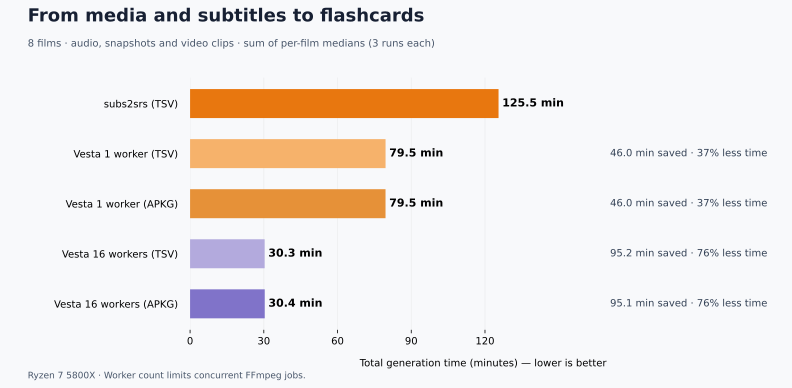

#  Vesta

[](https://github.com/pierspad/vesta/actions/workflows/ci.yml) [](https://github.com/pierspad/vesta/actions/workflows/build.yml) [](https://github.com/pierspad/vesta/releases/latest)

[](https://github.com/sponsors/pierspad) [](https://buymeacoffee.com/pierspad) [](https://ko-fi.com/pierspad)

**Contents:** [Overview](#what-it-does) · [Get started](#get-started) · [Workflow](#the-workflow) · [Benchmarks](#benchmarks) · [Architecture](#how-vesta-was-built) · [CLI](#headless-cli-use) · [Build](#building-from-source) · [Documentation](#documentation-map)

**Turn films, series and audio into Anki decks.**

Vesta is a desktop successor to subs2srs for language learners. Each subtitle becomes a card with dialogue, audio and a snapshot; add a translation or video clip if you want one. Preview and filter cards before exporting to Anki.

[](#benchmarks)

*Eight films: 126 minutes with subs2srs, 30 minutes with Vesta at 16 workers. [Measurement scope and results](#benchmarks).*

## What it does

- **Build Anki decks:** export `.apkg` packages, TSV decks with media folders, or send cards straight to Anki through AnkiConnect.
- **Prepare subtitles:** extract embedded text tracks, OCR bitmap or burned-in subtitles, correct timing drift, and compare files side by side.
- **Transcribe and enrich:** generate subtitles with local Whisper or cloud services, translate dialogue in batches, and add notes to existing decks.

Deck generation, subtitle editing, local Whisper transcription, and PaddleOCR run locally without cloud APIs. Optional cloud providers support tiered failover, and the **AI Kill Switch** in the sidebar cuts off AI features immediately.

## Get started

[Download the latest release](https://github.com/pierspad/vesta/releases/latest) for **Windows** (x64 / ARM64), **macOS** (Apple silicon), or **Linux** (DEB, RPM, Arch, Flatpak). Branch build artifacts and installer tests are covered in [setup and installer testing](docs/SETUP_TESTING.md).

1. Install **FFmpeg** and **FFprobe**, then complete the short first-run language setup.
2. Open **Flashcards**, load your video or audio, and add your study-language subtitles (plus native subtitles if available).
3. Filter and preview the cards, then export an `.apkg` to import into Anki.

Anki card word lookup (clicking a target word opens English Wiktionary) is enabled by default under **Settings → Anki**; custom note template rules are documented in the [setup guide](docs/SETUP_TESTING.md#check-anki-word-lookup-in-custom-templates).

## The workflow

Start in **Flashcards** when your subtitles match your media, or prepare tracks first:

| What you need | Tab |
|---|---|
| Embedded text tracks, bitmap OCR (PGS/VobSub/DVB/XSUB), or burned-in ROI OCR | **Extract subtitles** |
| Subtitles generated from audio/video (local Whisper or cloud speech-to-text) | **Transcribe** |
| Timing offset or drift fixed with manual anchors or Whisper Auto-Sync | **Synchronize** |
| Context-aware batch translation with checkpoint resume | **Translate** |
| Side-by-side subtitle editing and alignment | **Revise** |
| Notes, definitions, or grammar hints added to existing TSV/APKG decks | **Annotate** |

Configure API keys, local endpoints, and multi-tier failover under **Settings**.

## Benchmarks

**Eight films, 12,859 input subtitles, audio + snapshots + video clips.** On an AMD Ryzen 7 5800X at 16 workers, deck generation finished in **30 minutes** instead of **2 hours 6 minutes** with subs2srs — about **95 minutes saved (76%)**. A worker bounds concurrent media jobs rather than pinning CPU cores.

subs2srs and Vesta use different encoding defaults and produce different card counts, so treat this as a practical runtime comparison rather than an equal-quality test. Separately, **480 native A/B runs** verified Rust WebP snapshot batching: **15.3% less total runtime** for audio + snapshots + `.apkg` with identical media and note fields.

[Full report and charts](docs/BENCHMARK_REPORT.md) · [Native A/B evidence](docs/BENCHMARK_NATIVE.md) · [Reproduce benchmarks](docs/BENCHMARK_STEPS.md)

## How Vesta was built

Core engines live in standalone **Rust** crates (`core/`, `lib/`); **Tauri 2 + Svelte 5** power the desktop app, while **FFmpeg**, **whisper.cpp** (CPU with optional GPU offload and automatic CPU fallback), and pure-Rust **PaddleOCR v4 ONNX** handle media and offline recognition.

Desktop, CLI, and MCP adapters share the same engines. You can also embed the crates directly in another Rust application without Tauri: see [architecture](docs/ARCHITECTURE.md), [module APIs](docs/modules/README.md), and [library integration](docs/library-integration.md).

## Headless CLI Use

Run `vesta` without arguments to open the GUI, or pass an operation to run headlessly (`vesta-cli` is bundled alongside the GUI in official desktop installers and runs the same commands without desktop or Tauri dependencies; on Windows, use `vesta-cli.exe` for terminal output):

```bash
vesta flashcards generate \
  --target episode-ja.srt --native episode-en.srt --video episode.mkv \
  --output ./out_deck --format apkg --deck "Japanese — Episode 1" --no-video
```

Individual standalone commands (`cargo install --path cli/<crate>`) expose the same per-engine tools:

| Operation | Purpose | Standalone command |
|---|---|---|
| `flashcards` | Preview and generate TSV/APKG decks | `vesta-flashcards` |
| `extract` | Inspect SRTs and extract embedded text tracks | `vesta-extract` |
| `ocr` | OCR bitmap tracks or hardcoded video ROI subtitles | `vesta-ocr` |
| `sync` | Retiming with explicit manual anchors | `vesta-sync` |
| `autosync` | Whisper-assisted alignment | `vesta-autosync` |
| `transcribe` | Local Whisper or cloud speech-to-text | `vesta-transcribe` |
| `translate` | Tiered LLM translation with resume | `vesta-translate` |
| `refine` | Inspect and annotate existing TSV/APKG decks | `vesta-refine` |

CLI subcommands use their own flags and config files rather than desktop Settings; see the [CLI guide](docs/CLI.md) and [`vesta-cli`](cli/vesta-cli/README.md).

For MCP clients, run `vesta-cli mcp` (or standalone `vesta-mcp`) as a local stdio server with 24 tools for subtitle inspection, embedded track listing/extraction, video frame previews, dueling subtitles, card/batch previews & exports, APKG merging, deck inspection/editing, manual/automatic sync, AnkiConnect integration, local Whisper/VAD/OCR model management, cancellable flashcard/refine/translation/transcription/OCR jobs, and installed plugins, or copy the ready-to-paste client snippet from **Settings → Overview**; see [MCP setup and schemas](docs/MCP.md).

## Building from Source

Requires **Rust 1.99+**, **Node.js 22.12+**, npm, FFmpeg, and FFprobe (on Linux also a C/C++ compiler, CMake, pkg-config, `libwebkit2gtk-4.1-dev`, `libayatana-appindicator3-dev`, and `librsvg2-dev`; see [whisper build requirements](docs/modules/vesta-transcribe.md) for GPU backends).

```bash
git clone https://github.com/pierspad/vesta.git
cd vesta/apps/vesta-gui
npm ci
npx tauri dev
```

Tests, linters, Playwright checks, and release gates live in [CONTRIBUTING.md](CONTRIBUTING.md) and [quality verification](docs/QUALITY.md).

## Documentation Map

| Guide | Covers |
|---|---|
| [Documentation index](docs/README.md) | Full list of manuals, module docs, and feature scorecard |
| [CLI guide](docs/CLI.md) · [MCP guide](docs/MCP.md) | Commands, flags, JSON streams, stdio MCP tools, and limits |
| [Architecture](docs/ARCHITECTURE.md) · [Modules](docs/modules/README.md) | Workspace crates, pipelines, media lifecycle, and Rust APIs |
| [Library integration](docs/library-integration.md) · [Providers](docs/API_COMPATIBILITY.md) | Downstream embedding, Whisper patch, and HTTP endpoints |
| [Quality](docs/QUALITY.md) · [Maintenance](docs/MAINTENANCE.md) · [Setup](docs/SETUP_TESTING.md) | Pre-release gates, invariants, dependency notes, and installer checks |
| [Engineering Blueprint](docs/guide_to_create_good_software.md) | Reusable Rust/UI architecture, i18n gates, hash-verified feature DB, and CI/CD playbook |
| [Scorecard](docs/SCORECARD.md) | Feature matrix, live metrics, reliability controls, and active findings |
| [Benchmarks](docs/BENCHMARK_REPORT.md) | Methodology, reproduction steps, and native A/B measurements |

## Plugins

Plugins run out-of-process over JSON-RPC 2.0 stdio and render native UI through Vesta's declarative widgets without touching frontend code. Install from **Plugins → Local Folder / Repository URL**, start from the [Hello Counter example](docs/examples/plugin-hello), install the first-party [Subtitles plugin](https://github.com/pierspad/subtitles-veplugin), or read the [Plugin SDK spec](docs/PLUGINS.md).

## Contributing

Bug reports and pull requests are welcome. For major changes, open an issue first. See [CONTRIBUTING.md](CONTRIBUTING.md).

## LLM Disclosure

This project was developed with the assistance of Large Language Models, used to support code writing and documentation.

## License

Vesta is licensed under the [GNU General Public License v3](LICENSE).
